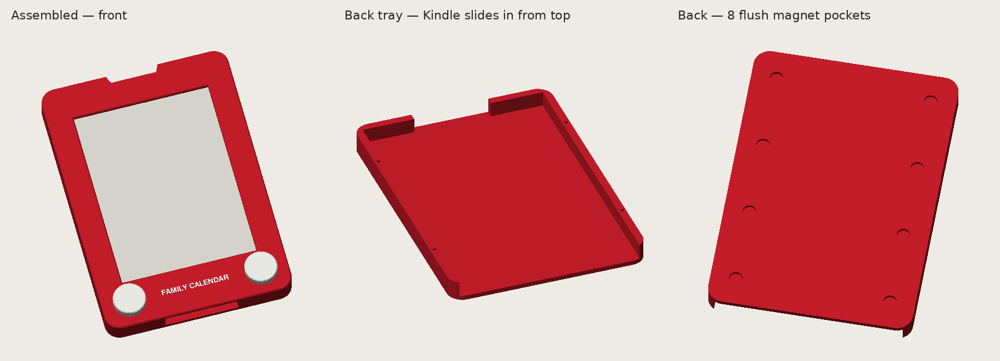

# Fridge mount — "Family Calendar" Etch-A-Sketch frame

A 3D-printable red frame with white knobs that holds the Kindle on the fridge as a calendar
display. The Kindle slides in from the top and can be pulled out to charge, or charged in place
through a slot in the bottom wall.



**Overall size:** about 128 × 180 × 16 mm. **Kindle pocket:** 117.5 × 169.5 × 9.8 mm, sized for the
169 × 117 × 9.1 mm body shared by the Paperwhite 1, 2 and 3.

## Parts

| File | Filament | Print orientation |
|---|---|---|
| `stl/A_tray_red.stl` | Red | Back face down. Pocket open at the top, 8 magnet pockets open to the bed. |
| `stl/A_face_red_plate-only.stl` + `stl/A_face_label_white.stl` | Red + white | Face up. Import **both together** as one multi-part object and set the label part to white. |
| `stl/A_face_red_white-text.stl` | Red, then white | Same face as one merged solid. Add a filament change at layer 13 (2.6 mm at 0.2 mm layers). |
| `stl/A_knob_white_x2.stl` | White, print 2 | Knob top down, peg up. |

Use one of the two face options, not both. No supports are needed for any part.

## Hardware

- **8 × disc magnets, 8 mm × 2 mm.** Pockets are 8.3 mm wide × 2.1 mm deep, flush with the
  back so the magnets touch the fridge directly. Glue in with CA, all facing the same way.
- A felt or thin rubber pad in the centre of the back helps stop the frame from sliding down.
- CA glue or epoxy to join the face to the tray.

## Assembly

1. Glue the magnets into the tray.
2. Four 2.5 mm pins on the tray's side walls locate the face. Glue the face onto the wall rims.
3. Press the knobs into their sockets on the face.
4. Slide the Kindle in from the top.

## Before printing

- **Check that the fridge door is magnetic.** Many stainless doors are not.
- **Check where the screen sits.** `SCREEN_BOTTOM` in `cad/kindle_frame.py` (27 mm, from the
  Kindle's bottom edge to the bottom of the e-paper) is an estimate. Measure it on your Kindle,
  or print the first 2–3 mm of the face and hold it over the screen.
- **Hall sensor:** the Kindle sleeps when a magnet is near its cover sensor. The magnets here sit
  at the back edges, but if the Kindle sleeps in the frame, see [`../hall-sensor/`](../hall-sensor/).

## Editing the model

The model is parametric [CadQuery](https://cadquery.readthedocs.io/). All dimensions are
constants at the top of `cad/kindle_frame.py`.

```sh
pip install cadquery
cd fridge-mount/cad
python kindle_frame.py ../stl            # rebuild the STLs and the STEP assembly
python render.py ../preview.png          # rebuild the preview image (needs Pillow)
```

`cad/A_assembly.step` is the assembled model for opening in other CAD software.
